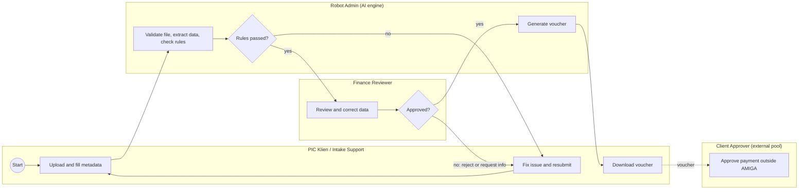
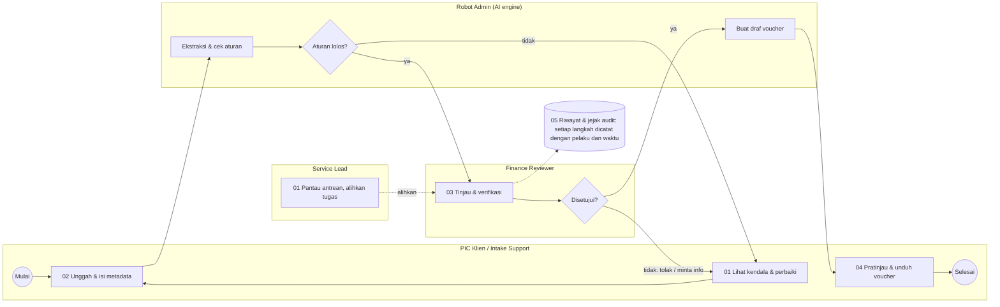

# AMIGA Hybrid Intake: BPMN, RBAC and User Stories

## Overview

This document defines the BPMN structure, screen flow, role-based access control and user stories for AMIGA's hybrid document intake, from client upload to voucher download. Payment approval by the Client Approver happens outside AMIGA. The flow after extraction (voucher generation, rejection paths) is not in the source table, so those parts are marked as assumptions.

| Role | Does | Must not |
| --- | --- | --- |
| Intake Support | Uploads documents, fills metadata, resolves issues, downloads voucher, manages client data | Review documents they uploaded themselves |
| Robot Admin (AI Engine) | Extracts data and verifies business rules | Approve vouchers |
| Finance Reviewer | Checks, corrects, approves or rejects extraction results | Review documents they uploaded themselves |
| Service Lead | Monitors workload and reallocates tasks | Authorize client payments |
| System Admin | Manages accounts, access rights, delegations, and client data | Access transaction approval |
| Client Approver | Approves payment outside AMIGA | Out of scope of the application (external user) |

## BPMN structure

Failed rule checks loop back to the client side, and only Finance approval triggers voucher generation. The diagram simplifies the full table below.

The model uses one pool, "AMIGA", with lanes for Intake Support, Robot Admin (AI Engine), Finance Reviewer, Service Lead and System Admin. The Client Approver is a collapsed external pool connected by message flow only, since payment approval happens outside AMIGA.

### Main process: document intake to voucher

| # | Lane | Element | Type |
| --- | --- | --- | --- |
| 1 | Intake Support | Start: client needs to submit documents | Start event |
| 2 | Intake Support | Upload document and fill in metadata (including tax type) | User task |
| 3 | Robot Admin | Validate file (format, size, duplicate) | Service task |
| 4 | Robot Admin | Extract data | Service task |
| 5 | Robot Admin | Verify business rules | Service task |
| 6 | Robot Admin | Rules passed? | Exclusive gateway |
| 7a | Intake Support | If failed: resolve the issue (fix metadata or re-upload), then loop back to step 3 | User task |
| 7b | Finance Reviewer | If passed: check extraction results | User task |
| 8 | Finance Reviewer | Correction needed? If yes, correct the data | Exclusive gateway + user task |
| 9 | Finance Reviewer | Approve / Reject / Request client info | Exclusive gateway |
| 10 | Robot Admin | Generate voucher (after approval only) | Service task |
| 11 | Intake Support | Download voucher | User task |
| 12 | Intake Support | Send voucher to Client Approver (message flow to the external pool) | Send task |
| 13 | Intake Support | End: voucher delivered | End event |

### Alternate paths and supporting elements

- **Rejected:** Finance Reviewer can reject the document, which returns it to Intake Support with status "Needs Action". Intake Support must fix the issue (with or without uploading a new file) before resubmitting.
- **Request info:** notify Intake Support, then loop back to fix step.
- **Service Lead:** a non-interrupting timer or message event on review task ("task waiting too long") leads to "Monitor workload", then "Reassign task" back to the Finance Reviewer lane.
- **System Admin:** manages accounts, access rights, client data, and delegations. Both System Admin and Intake Support can add new client data.
- **Segregation of duties:** a business-rule task before review ("Reviewer ≠ uploader"). If it fails, the system reassigns to another Finance Reviewer.

## Screen flow for the front end

Each of the five UI screens sits at one point of the intake flow, and screen 05 records every step. Each screen is built for specific roles, not as an all-purpose dashboard.

| Screen | Main roles | What it shows | Key rule |
| --- | --- | --- | --- |
| 01 Work queue dashboard | All roles | Job status summary, filtering by client, deadlines and blockers | Intake Support sees only delegated clients; Service Lead can reassign |
| 02 Document upload | Intake Support | Invoice upload form with metadata: client, request type, **tax type**, channel, date, notes | Tax type includes PPh 21, PPh 23, PPh 4 ayat 2, PPN, etc. Upload logs include client PT name and PIC |
| 03 Review and verification | Finance Reviewer | Split screen: original document on left, editable extracted data with validation on right | Cannot review own uploads; can approve or **reject back to Intake Support** |
| 04 Voucher preview | Intake Support, Finance Reviewer | Draft voucher with new format: "Voucher pengeluaran", table layout, BOD signature | Download opens only after Finance approval |
| 05 History and audit trail | All roles | Activity timeline, rejection notes and data revisions from start to end | Every correction stores old value, new value, user and time |
| 06 Client management | System Admin, Intake Support | Add and view client data: PT name, PIC name, email, phone, address | Sequential numbering per client for invoice tracking |

## Role-based access control (RBAC)

Each role gets its own workspace, its own work queue and its own audit trail, and the server refuses everything else; hiding a button is never the control. Access is denied by default and checked on every request against three things: the role's permissions, the record's scope, and segregation of duties.

### Permission matrix

| Role | Own screens | Work queue scope | Audit trail scope | Allowed | Denied |
| --- | --- | --- | --- | --- | --- |
| Intake Support | Queue, Upload, Client Management, Voucher, Fix Rejected, Audit | Clients in active delegation + own clients | Events on those clients | Upload, fix and resubmit, download approved vouchers, add client data | Review or approve anything; see other Intake Support's clients outside delegation |
| Finance Reviewer | Queue, Review, Voucher preview, Audit | Review tasks assigned to them | Events on those tasks | Read extraction, correct data, approve, **reject back to Intake Support**, request info | Own uploads; other reviewers' tasks; voucher download; reassign |
| Service Lead | Workload, Workload audit | All tasks, status and assignment only | Assignment and workload events only | Monitor workload, reassign tasks | Document content and amounts; approve; authorize client payment |
| System Admin | Access requests, Accounts and delegations, Client Management, Audit | Access requests | Account, role, delegation, client data changes and denied access attempts | Manage accounts, roles, delegations, add/edit client data | Any document or transaction; approve transactions; change own role |
| Robot Admin | No interface | System process | Writes its own events | Extract data, verify rules | Approve vouchers |
| Client Approver | No interface | External user | None | Approve payment outside AMIGA | Out of application scope |

### Enforcement rules

1. **Deny by default.** A request needs a permission such as `doc:decide:assigned`; the scope suffix (own, delegated, assigned) is then checked against the record.
2. **Data minimisation.** The queue returns a different shape per role. Service Lead gets status and assignee only, with no extracted fields or amounts.
3. **Segregation of duties.** A Finance Reviewer who uploaded a document cannot read, correct or approve it, and the Service Lead cannot reassign it back to the uploader.
4. **Delegation is live.** Revoking or expiring a delegation closes the Intake Support's access on the next request.
5. **Denials are logged.** Every refused request is written to the audit trail that System Admin reads.
6. **No role switcher.** A user signs in to one role's workspace; to act in another role they sign in as a different account.

### In production

The prototype enforces these rules in browser code to show the behaviour, which is not secure. In production the same policy must run on the server: map roles to Cognito groups, check the group and record scope in an API Gateway authorizer and again inside each Lambda, and filter records by owner, delegation or assignee in the query itself so out-of-scope data is never returned.

## User stories

Fifteen user stories in five epics cover upload, automated processing, review, administration and the external boundary.

### Epic A: Upload and submit

**US-01 Upload documents (Intake Support).** As Intake Support, I want to upload documents for my clients so that they can be processed.

- Given I'm logged in, when I upload a supported file with required metadata including tax type, then it appears in the queue with status "Uploaded".
- Unsupported or duplicate files are rejected with a clear message.

**US-02 Fill metadata (Intake Support).** As Intake Support, I want to fill in the document metadata including client PT name, PIC name, tax type, and other details so that the system and reviewers have the context they need.

- Required fields including tax type are validated before I can submit.
- Tax type options include PPh 21, PPh 23, PPh 4 ayat 2, PPN, PPh Final, and "Tidak ada".
- Sequential numbering is automatically assigned per client for tracking.

**US-03 Manage client data (Intake Support / System Admin).** As Intake Support or System Admin, I want to add new client data including PT name, PIC name, contact info so that new clients can be served.

- I can add client data with required fields: PT name, PIC name, email.
- Optional fields include phone and address.
- Each client gets a sequential number tracker starting from 1.

**US-04 Fix rejected documents (Intake Support).** As Intake Support, I want to fix documents rejected by Finance so that they can be resubmitted for review.

- I can upload a new file to replace the rejected one.
- I can add notes explaining the fix without uploading a new file.
- Fixed documents return to Finance review queue.

**US-05 Track status (Intake Support).** As Intake Support, I want to see the status of each submission (Uploaded, Processing, Under Review, Needs Action, Approved, Rejected).

### Epic B: Automated processing

**US-06 Extraction and rule check (Robot Admin).** As the system, I want to extract data and check it against business rules so that reviewers receive structured, pre-checked data.

- Each extracted field shows a confidence score.
- Rule violations are listed with a reason code.
- The robot cannot approve or issue a voucher.

### Epic C: Review and approval

**US-07 Review extraction (Finance Reviewer).** As a Finance Reviewer, I want to compare extracted data against the source document side by side.

- Fields flagged by rules or low confidence are highlighted.

**US-08 Correct and decide (Finance Reviewer).** As a Finance Reviewer, I want to correct extracted values and then approve, **reject back to Intake Support**, or request more information.

- Every correction is logged with the old value, new value, user, and time.
- **Rejection returns document to Intake Support with status "Needs Action" for fixing.**
- Rejection and info requests require a reason.

**US-09 Segregation of duties (Finance Reviewer).** As the business, I want reviewers blocked from reviewing documents they uploaded themselves.

- The task is hidden from the uploader's queue, and direct access is denied.

**US-10 Download voucher (Intake Support).** As Intake Support, I want to download the voucher once it's approved with the new format.

- The download button appears only after Finance approval.
- Voucher shows "Voucher pengeluaran" format with table layout and BOD signature.
- Downloads are logged.

### Epic D: Workload and administration

**US-11 Monitor workload (Service Lead).** As a Service Lead, I want a dashboard of open tasks per reviewer, aging, and SLA breaches.

**US-12 Reassign tasks (Service Lead).** As a Service Lead, I want to reassign review tasks to another reviewer.

- I cannot approve or authorize client payments.
- Reassignment is logged.

**US-13 Manage accounts and access (System Admin).** As a System Admin, I want to create accounts, assign roles, manage client data, and manage delegations.

- I have no access to approve transactions.
- I can add new client companies with PT name, PIC name, and contact details.

**US-14 Manage delegations (System Admin).** As a System Admin, I want to create, scope, and revoke Intake Support delegations to specific clients, optionally with an expiry date.

### Epic E: Boundary

**US-15 External payment approval (Client Approver).** As a Client Approver (external user), I approve payment outside AMIGA using the voucher provided.

- No login or screens are needed. AMIGA shows the voucher as "Delivered", and any payment status is out of scope.

## Assumptions to confirm

Four points in the flow are not covered by the source table and need a business answer.

1. The voucher is generated automatically after Finance approval. Is there a second approver?
2. Can the PIC Klien themselves send the voucher to the Client Approver, or is it sent by email or another channel?
3. After rejection, can the client resubmit under the same case or must they start a new one?
4. Are there SLA targets for the Finance Reviewer queue? They would drive the Service Lead timer event.
