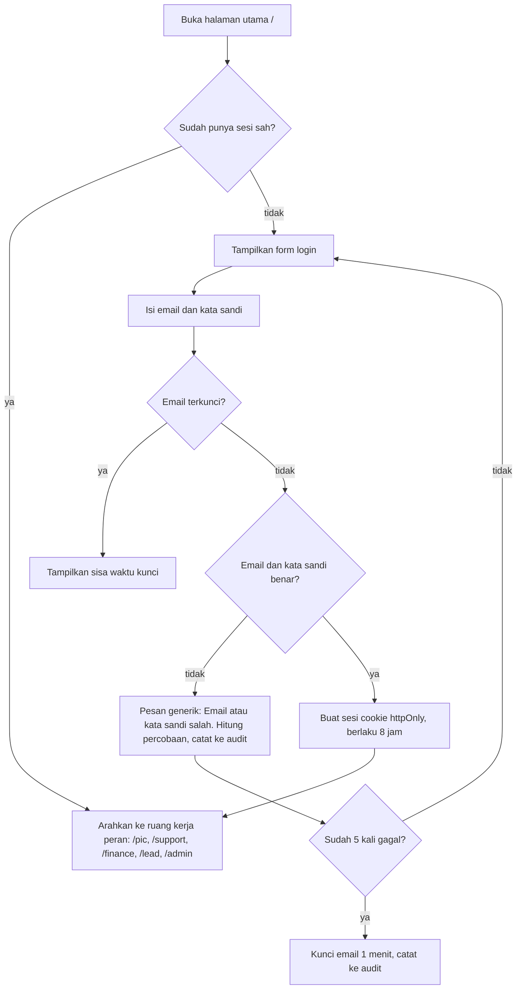

# Update: Halaman Login sebagai Halaman Utama

Pembaruan ini mengganti pemilih akun contoh dengan halaman login sungguhan (email dan kata sandi) yang menjadi halaman utama aplikasi. Setelah berhasil masuk, pengguna langsung diarahkan ke ruang kerja sesuai perannya.

## Ringkasan perubahan

| Sebelum | Sesudah |
| --- | --- |
| `/login` berisi daftar kartu akun, tinggal klik "Masuk sebagai ..." | Halaman utama `/` berisi form email dan kata sandi |
| Tidak ada verifikasi kata sandi | Kata sandi diverifikasi di server dengan hash scrypt |
| Tidak ada pembatasan percobaan | Email dikunci 1 menit setelah 5 kali gagal |
| Login gagal tidak tercatat | Login gagal dan penguncian tercatat di riwayat audit System Admin |
| Akun contoh selalu tampil | Akun contoh hanya tampil bila `DEMO_MODE` tidak `off` |

## Alur login



## Tampilan

- Layar terbagi dua. Panel kiri berisi logo, judul "Satu pintu, ruang kerja sesuai peran Anda", dan tiga poin: akses per peran, jejak audit, voucher setelah persetujuan Finance.
- Panel kanan berisi kartu login: email, kata sandi dengan tombol Tampilkan/Sembunyikan, tombol Masuk, tautan "Lupa kata sandi?" dan panel "Akun contoh untuk mencoba".
- Di layar kecil, panel kiri mengecil dan form tampil di bawahnya. Tiga poin disembunyikan agar form langsung terlihat.
- Warna memakai palet lembut yang sama dengan seluruh aplikasi, termasuk mode gelap.
- Pesan galat memakai `role="alert"` agar terbaca pembaca layar, dan kolom email otomatis fokus saat halaman dibuka.

## Perilaku keamanan

- **Hash kata sandi:** scrypt dengan salt acak per akun, dibandingkan memakai `timingSafeEqual`.
- **Pesan generik:** email yang tidak terdaftar dan kata sandi salah menghasilkan pesan yang sama, sehingga tidak membocorkan email mana yang ada. Email yang tidak dikenal tetap diproses dengan waktu yang serupa lewat hash pembanding.
- **Pembatasan percobaan:** 5 kali gagal berturut-turut mengunci email itu selama 1 menit. Login berhasil mereset hitungan.
- **Audit:** setiap login gagal dan penguncian ditulis sebagai peristiwa keamanan yang dibaca System Admin di riwayat audit.
- **Sesi:** cookie `httpOnly`, `sameSite=lax`, dan `secure` di produksi, berlaku 8 jam. Peran dibaca ulang dari data terbaru pada setiap permintaan, jadi perubahan peran berlaku tanpa menunggu sesi habis.
- **Batas input:** email dan kata sandi lebih dari 200 karakter langsung ditolak.

## Akun contoh

Semua akun contoh memakai kata sandi `amiga2026` (bisa diganti lewat `DEMO_PASSWORD`).

| Peran | Email |
| --- | --- |
| PIC Klien | `dewi@amiga.demo`, `eko@amiga.demo` |
| Intake Support | `andi@amiga.demo` |
| Finance Reviewer | `rina@amiga.demo`, `hana@amiga.demo` |
| Service Lead | `bayu@amiga.demo` |
| System Admin | `sari@amiga.demo` |

## Konfigurasi

Tambahan di `.env.example`:

```bash
# Akun contoh di halaman login. Kata sandi semua akun contoh = DEMO_PASSWORD.
# Setel DEMO_MODE=off di produksi untuk menyembunyikan daftar akun dan kata sandi contoh.
DEMO_MODE=on
DEMO_PASSWORD=amiga2026
```

`amplify.yml` kini ikut meneruskan `DEMO_MODE` dan `DEMO_PASSWORD` ke runtime. Untuk deploy, isi `DEMO_MODE=off` di Environment variables Amplify.

## File yang berubah

**Baru**

| File | Fungsi |
| --- | --- |
| `src/lib/password.ts` | Hash dan verifikasi kata sandi (scrypt) |
| `src/lib/auth.ts` | Verifikasi email dan kata sandi, pembatasan percobaan, catatan audit |
| `src/components/LoginForm.tsx` | Form login (client component) |

**Diubah**

| File | Perubahan |
| --- | --- |
| `src/app/page.tsx` | Menjadi halaman login. Pengguna yang sudah masuk diarahkan ke ruang kerjanya |
| `src/app/login/page.tsx` | Hanya mengalihkan ke `/` |
| `src/lib/actions.ts` | `login(formData)` diganti `signIn(email, password)`. Keluar kini kembali ke `/` |
| `src/lib/store.ts` | Menambah `creds` (email dan hash) dan `attempts` (hitungan percobaan) |
| `src/lib/session.ts` | Pengalihan pengguna tanpa sesi ke `/` |
| `src/middleware.ts` | `/` diizinkan tanpa sesi, selain itu diarahkan ke `/` |
| `src/app/globals.css` | Gaya halaman login |
| `.env.example`, `README.md`, `amplify.yml` | Variabel dan dokumentasi baru |

## Cara menguji

1. Jalankan `npm run dev`, buka `http://localhost:3000`. Anda akan melihat halaman login.
2. Masuk sebagai `rina@amiga.demo` / `amiga2026`. Anda masuk ke `/finance`.
3. Coba kata sandi salah. Pesan galat generik muncul dan kolom kata sandi dikosongkan.
4. Salah 5 kali untuk satu email. Muncul pesan terkunci beserta sisa detik.
5. Masuk sebagai `sari@amiga.demo` lalu buka Riwayat audit. Percobaan gagal dan penguncian terlihat sebagai peristiwa keamanan.
6. Tekan Keluar. Anda kembali ke halaman login, dan membuka `/finance` langsung akan dialihkan ke sana.

## Status pengujian

- Logika `authenticate` sudah diuji: login benar, huruf besar dan spasi pada email, kata sandi salah, email tidak dikenal, kolom kosong, penguncian setelah 5 kali gagal, dan hash tidak tersimpan sebagai teks biasa.
- Versi prototipe (halaman yang dipublikasikan) sudah dicoba di browser untuk login gagal lalu berhasil, tampilan desktop dan HP, tanpa error skrip.
- Versi Next.js belum dijalankan penuh (`next build`) karena lingkungan pembuatan tidak punya akses internet. Jalankan `npm run typecheck` dan `npm run build` sekali sebelum push.

## Keterbatasan dan langkah berikutnya

- Penghitung percobaan disimpan di memori server, jadi di lingkungan serverless setiap instance punya hitungan sendiri dan hitungan hilang saat restart. Untuk produksi, simpan di penyimpanan bersama.
- Belum ada autentikasi dua langkah (MFA), pengingat sesi habis, dan atur ulang kata sandi mandiri. "Lupa kata sandi?" saat ini hanya mengarahkan pengguna menghubungi System Admin.
- Untuk produksi, ganti login ini dengan Amazon Cognito (OIDC) dan petakan grup Cognito ke peran. Cognito menyediakan MFA, atur ulang kata sandi, dan pembatasan percobaan bawaan.
- Setel `DEMO_MODE=off` sebelum deploy agar daftar akun dan kata sandi contoh tidak tampil.
